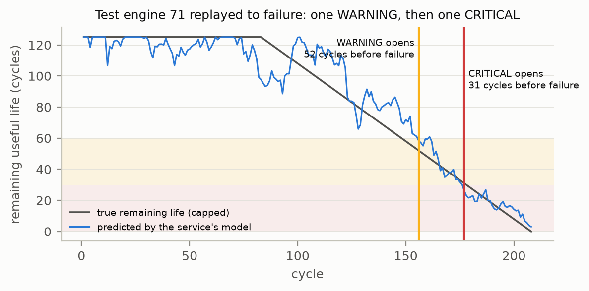
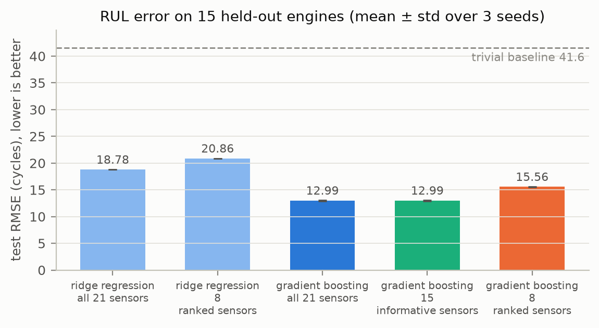
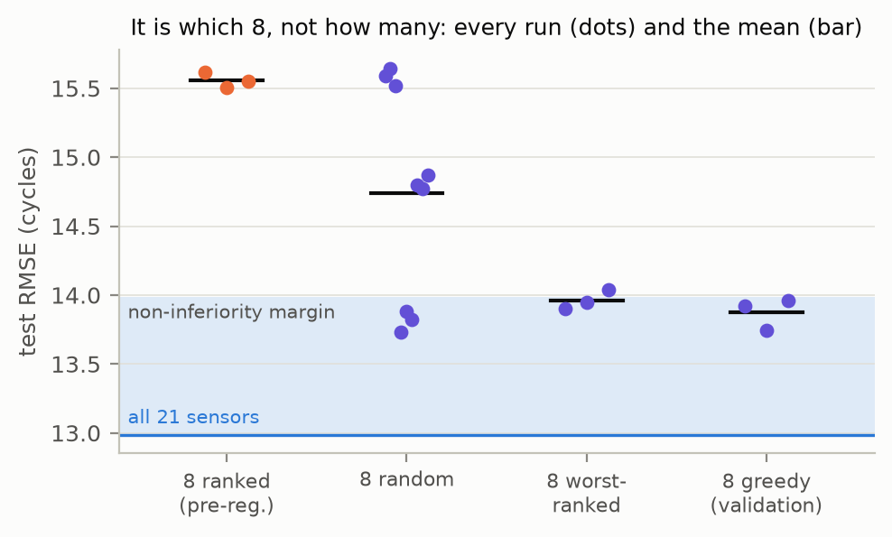
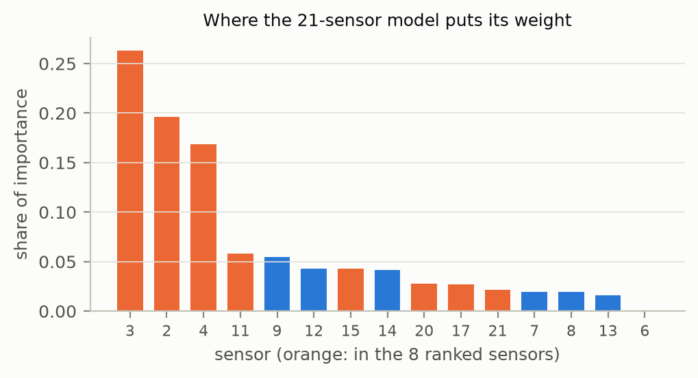
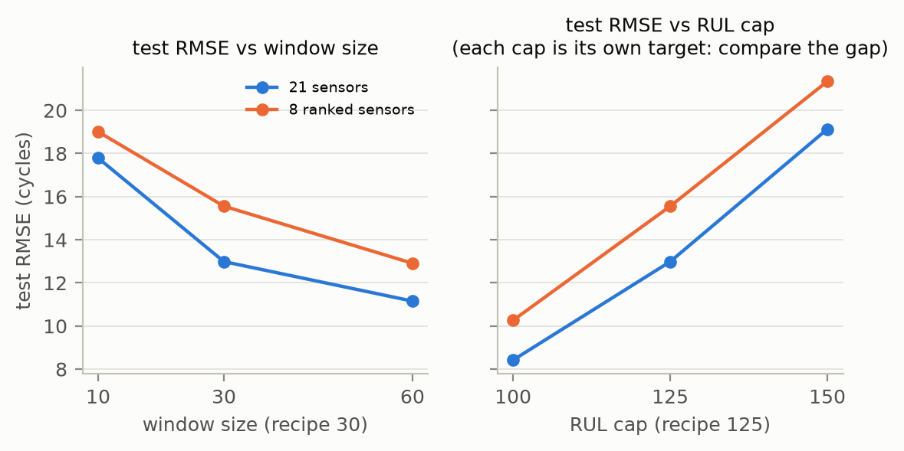
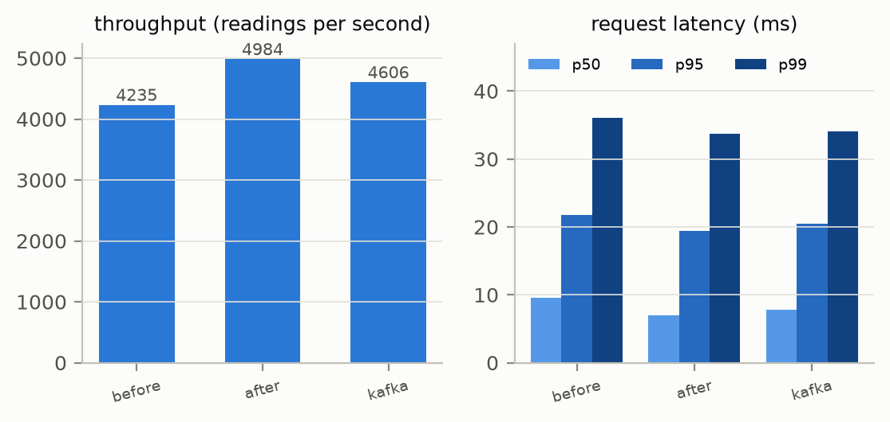
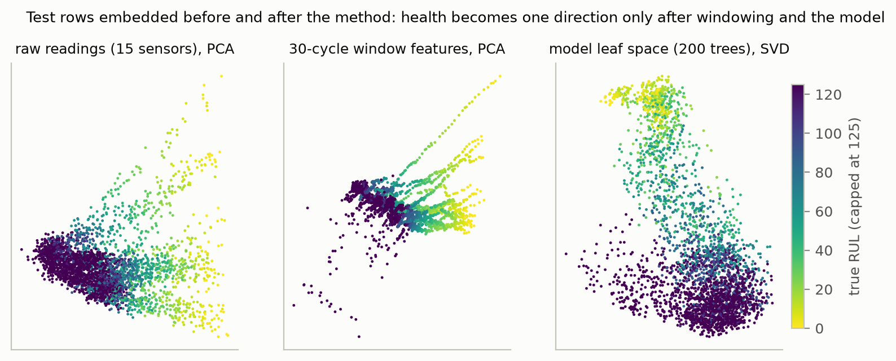
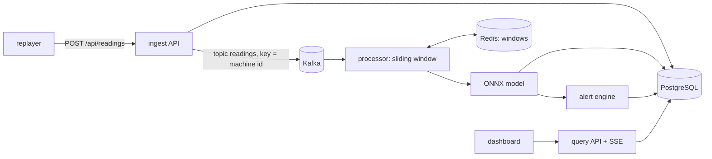
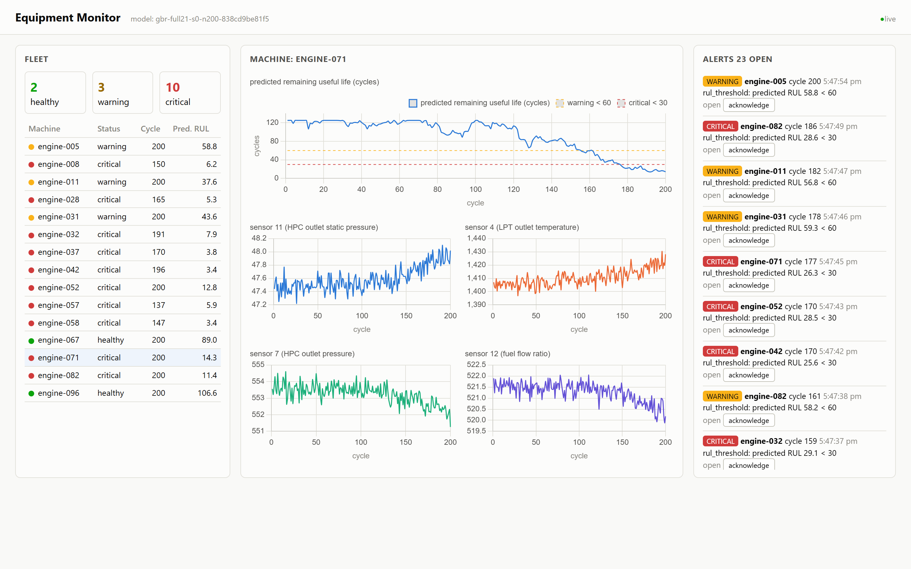

<!-- Generated by model/report.py from report/README.template.md. Edit the template, not this file. -->
# equipment-health-monitor

A Java 21 / Spring Boot service that ingests live sensor readings from turbofan engines, keeps a sliding
window per machine, scores each machine's remaining useful life (RUL) with an in-process ONNX model,
raises de-duplicated alerts, and shows the fleet on a live dashboard. Kafka sits between ingest and
processing; PostgreSQL, Redis, Testcontainers, k6 and Micrometer complete the stack.



## The question

The service should run on as few sensors as possible: every sensor is hardware, wiring and a failure
mode. The sensor-reduction question behind it, asked before any model was trained:

> **Does a model on the 8 highest-ranked sensors predict remaining life as well as one on all 21?**
> Pre-registered as non-inferiority: the 8-sensor model may be worse by less than 1.0 cycle of
> test RMSE, averaged over 3 seeds.

**Answer: no, not with the pre-registered selection rule.** The 8 ranked sensors are
2.57 cycles worse (paired by seed: 2.49 to 2.68), so the service
ships the 21-sensor model, as the pre-registered deployment rule says.

Post hoc ablations then show that *which* 8 matters more than *how many*:

* 8 sensors chosen by forward selection on the validation engines come within 0.89 cycles
  of the full model, inside the margin.
* The 8 *lowest*-ranked sensors land at 0.97 cycles, also inside, by a hair.
* Random 8-sensor draws land between 0.83 and 2.60.

The ranking picked sensors that move together: their mean pairwise correlation is
0.97, against 0.52 for the lowest-ranked set.

## Honesty note

* **The data is a simulation.** NASA C-MAPSS FD001 is a physics-based run-to-failure simulation of
  turbofan engines, a NASA benchmark dataset, not field data from real engines.
* **What was fixed in advance.** The split, metric, window, label cap, model, hyper-parameters, the
  number-of-trees grid, the validation-only selection rule, the seeds, the hypothesis with its margin,
  and the deployment rule are in [`model/config/experiment.json`](model/config/experiment.json),
  committed before the first main result existed. Two amendments touch only how the chosen model is
  shipped: the deployment rule, and float32 ONNX input after the double-precision path proved impossible.
  Because the second landed while the queue was running, the main runs recorded
  2 config hashes: 0b24782979f5 (full21); 838cd9be81f5 (informative15, reduced8).
  [`model/config_audit.py`](model/config_audit.py) compares the file with the pre-registration commit field by
  field. Changed: deployment_rule, onnx. Fields that affect training, selection or evaluation:
  0. Verdict: recipe unchanged.
* **What was decided afterwards.** Every ablation, the leaky-split comparison, and the redesigned alert
  trend rule are post hoc. They are labelled `posthoc` in [`results/runs.csv`](results/runs.csv) and
  in every table. The alert rule was redesigned on the validation engines and checked once on the test
  engines.
* **Where the numbers come from.** Every number on this page is generated from `results/` by
  `model/report.py`; none is typed by hand. The same numbers feed the paper through `report/numbers.tex`.
* **What is not verified here.** There is no cloud deployment and therefore no live link: it needs an
  account on a hosting provider. Docker Compose and the Testcontainers path run in GitHub Actions only;
  the build machine has no Docker, so locally the integration tests ran against native PostgreSQL 17,
  Redis and Kafka. All performance numbers come from one Windows laptop.

## Results

### The model

| Method                                    |   Seeds | Test RMSE    | Test MAE     | NASA score    |   Status acc. |   Macro-F1 |   CRITICAL recall | Official RMSE   |
|:------------------------------------------|--------:|:-------------|:-------------|:--------------|--------------:|-----------:|------------------:|:----------------|
| trivial (train mean), all 21 sensors      |       1 | 41.58 ± 0.00 | 36.98 ± 0.00 | 302.35 ± 0.00 |         0.717 |      0.278 |             0     | 41.97 ± 0.00    |
| ridge regression, all 21 sensors          |       1 | 18.78 ± 0.00 | 14.26 ± 0.00 | 7.28 ± 0.00   |         0.85  |      0.7   |             0.64  | 19.45 ± 0.00    |
| ridge regression, 8 ranked sensors        |       1 | 20.86 ± 0.00 | 15.61 ± 0.00 | 9.21 ± 0.00   |         0.849 |      0.695 |             0.616 | 21.33 ± 0.00    |
| gradient boosting, all 21 sensors         |       3 | 12.99 ± 0.07 | 9.40 ± 0.09  | 2.86 ± 0.04   |         0.921 |      0.845 |             0.933 | 13.22 ± 0.12    |
| gradient boosting, 15 informative sensors |       3 | 12.99 ± 0.07 | 9.40 ± 0.09  | 2.86 ± 0.04   |         0.921 |      0.845 |             0.933 | 13.22 ± 0.12    |
| gradient boosting, 8 ranked sensors       |       3 | 15.56 ± 0.06 | 11.15 ± 0.07 | 4.35 ± 0.07   |         0.913 |      0.832 |             0.935 | 15.35 ± 0.27    |

Test = 3183 rows of 15 engines never seen in training or selection; mean ± standard deviation
over 3 seeds; the trivial and ridge baselines are deterministic. "Official RMSE" is the
literature's FD001 benchmark (last cycle of each of the 100 truncated test trajectories).

* Gradient boosting on all 21 sensors predicts remaining life to 12.99 cycles
  RMSE, 3.2 times better than predicting the mean.
* **15 informative sensors give exactly the same model.** Sensors 1, 5, 10, 16, 18, 19 are constant in
  FD001; the audit found 0 tree splits on them, so dropping them changes nothing.
* **Accuracy misleads.** The trivial model scores 71.7%
  status accuracy because most rows are HEALTHY, yet it never catches a CRITICAL machine
  (CRITICAL recall 0.000). Macro-F1 and CRITICAL recall
  are reported next to it for that reason.



### Which 8 sensors (post hoc)

| Sensor set                      | Chosen by                      | Test RMSE    |   Gap to 21 | Within 1.0   | Phase          |
|:--------------------------------|:-------------------------------|:-------------|------------:|:-------------|:---------------|
| all 21 sensors                  | all                            | 12.99 ± 0.07 |        0    |              | pre-registered |
| 8 ranked sensors                | pre-registered ranking (train) | 15.56 ± 0.06 |        2.57 | no           | pre-registered |
| 8 sensors, greedy on validation | forward selection (validation) | 13.88 ± 0.12 |        0.89 | yes          | post hoc       |
| 8 random sensors (3 draws)      | random                         | 14.74 ± 0.77 |        1.75 | no           | post hoc       |
| 8 lowest-ranked sensors         | bottom of the ranking          | 13.96 ± 0.07 |        0.97 | yes          | post hoc       |



The pre-registered ranking scored each sensor alone by its rank correlation with RUL. It picked sensors
2, 3, 4, 11, 15, 17, 20, 21. They all track the same degradation signal: the mean absolute correlation between
their window means is 0.97, so 8 of them carry little more than one. The ranking left
out sensors 9, 12, 14, 7, which carry 19.5% of the full model's
importance. Forward selection on validation picked 8, 9, 11, 12, 13, 14, 17, 20 (redundancy 0.62).
The lowest-ranked set has redundancy 0.52; it lands inside the margin only by a hair,
and with three seeds that edge is not a finding.



### The recipe matters as much as the idea (post hoc)

| Setting            | 21 sensors   | 8 ranked sensors   |   Gap | Within 1.0   |
|:-------------------|:-------------|:-------------------|------:|:-------------|
| window 10          | 17.79 ± 0.04 | 19.01 ± 0.04       |  1.22 | no           |
| window 30 (recipe) | 12.99 ± 0.07 | 15.56 ± 0.06       |  2.57 | no           |
| window 60          | 11.16 ± 0.11 | 12.91 ± 0.01       |  1.75 | no           |
| cap 100            | 8.42 ± 0.06  | 10.26 ± 0.10       |  1.84 | no           |
| cap 125 (recipe)   | 12.99 ± 0.07 | 15.56 ± 0.06       |  2.57 | no           |
| cap 150            | 19.14 ± 0.05 | 21.35 ± 0.12       |  2.21 | no           |



The 8 ranked sensors never reach the margin, but the size of the gap depends on the window length. The
window length alone moves the 21-sensor error by 1.83 cycles, about as much as
the sensor reduction does. **Read the main result as "under this recipe", not as a property of the sensors.**

### The methodological gap (post hoc)

Splitting rows at random, so that cycles of one engine land in both training and test, reports
10.08 cycles RMSE for the same model. That is 2.91 cycles
(22%) better than the honest engine-level split, and all of it is leak.
`tests/test_split.py` fails if any engine appears in two splits.

### The service

| Check | Result |
| --- | --- |
| Stage 1: all 100 engines replayed, rows in PostgreSQL = rows in the file | 20631 = 20631 |
| Stage 3: Java ONNX prediction vs Python, 300 real test rows | within the 1e-3 tolerance; 44.4 µs per prediction |
| Stage 4: held-out engines with exactly one WARNING then one CRITICAL | 15 of 15 |
| Stage 4: true cycles left when CRITICAL opens (mean, minimum) | 31.7, 21 |
| Stage 5: processor killed mid-stream, readings stored / scored | 20631 / 20631 of 20631 |
| Stage 5: scores and alerts identical to an uninterrupted run | max score difference 9e−05; 0 machines differ |
| Tests | 55 Java, 16 Python, all passing |
| Line coverage, processing and alert code | 92.1% |

**Throughput:** 4984 readings per second at p95 latency of 19.4 ms
(p99 33.7 ms) on a laptop, k6 against `POST /api/readings`.

| Run    | Pipeline   |   Users |   Batch |   Readings/s |   p50 ms |   p95 ms |   p99 ms |   Pool waits | Change             |
|:-------|:-----------|--------:|--------:|-------------:|---------:|---------:|---------:|-------------:|:-------------------|
| before | direct     |      50 |       1 |         4235 |     9.51 |    21.8  |    36.11 |        32.85 |                    |
| after  | direct     |      50 |       1 |         4984 |     7    |    19.4  |    33.7  |         1.39 | MONITOR_DB_POOL=40 |
| kafka  | kafka      |      50 |       1 |         4606 |     7.8  |    20.43 |    34.12 |         3.52 | MONITOR_DB_POOL=40 |



Details, the bottleneck found and the fix: [`docs/load-test-report.md`](docs/load-test-report.md).

## Error analysis

The service turns a predicted RUL into a status (HEALTHY above 60, WARNING, CRITICAL below 30), so errors are
counted as status confusions: 248 of 3183 test rows
(7.8%). The most frequent is WARNING predicted as HEALTHY (135
rows), then WARNING predicted as CRITICAL (58). HEALTHY was never predicted
CRITICAL (0 rows), nor the reverse (0).

35 misclassified rows were inspected by eye on whole-engine plots
([`error_analysis/`](error_analysis/)):

* **3 ambiguous:** a small error that crosses a neighbouring boundary. Across all
  misclassified rows, 27% have an error of 10 cycles or less.
* **0 mislabeled:** FD001 labels are exact cycle counts from a simulation, so none were expected.
* **32 real model errors**, in four shapes:
  * lagging (16): the prediction stays high on engines that fail fast, because early
    sensors cannot know how fast an engine will degrade;
  * early (8): the prediction runs ahead of the truth near the end of long-lived engines;
  * jitter (8): single-reading spikes or steps;
  * plateau (2): tree output stuck near 60, exactly on the WARNING line.



## How it works



One reading, end to end, the ordering rule, crash safety and the alert semantics are in
[`docs/architecture.md`](docs/architecture.md).

## Design decisions

| Decision | Choice | Why, in one line |
| --- | --- | --- |
| [Kafka between ingest and processing](docs/decisions/0001-kafka-between-ingest-and-processing.md) | yes, added in stage 5 | a processor crash loses nothing, and ingest latency no longer includes the model |
| [Sensor values](docs/decisions/0002-sensor-columns-vs-json.md) | typed columns | fixed schema, half the bytes of JSON, typed validation at insert |
| [Model serving](docs/decisions/0003-onnx-in-process.md) | ONNX Runtime in-process | microseconds instead of an HTTP hop; a parity test guards it |
| [Window state](docs/decisions/0004-window-state-and-ordering.md) | Redis, saved after scoring | a restart resumes exactly; late readings are ignored, gaps tolerated |
| [Storage](docs/decisions/0005-postgresql-vs-time-series-database.md) | PostgreSQL | the hot window lives in Redis; the volume does not need a TSDB yet |
| [Live updates](docs/decisions/0006-server-sent-events-vs-websockets.md) | Server-Sent Events | one-way, plain HTTP, reconnects by itself |

## Mistakes caught on the way

* The first alert trend rule fired on the model's reading-to-reading jitter. It passed the stage 4 check
  on only 2 of 15 validation engines.
* A Python simulator of the alert engine, cross-checked against the service, exposed a Java bug: the
  first score after a restart was counted twice.
* The processor saved the window before scoring it, so a crash between the two would have lost a score.
* Integration tests shared the dev Redis and left windows behind, and every later reading was ignored as late.
* On Windows, deleting a Kafka topic makes the broker shut down, so experiments use a fresh topic per run.

## Limitations

* FD001 is one operating condition and one fault mode, simulated. Nothing here shows the model or the
  alert thresholds transfer to FD002 to FD004, let alone to real engines.
* The alert rule passes on all held-out engines, but replaying all 100 engines, including training
  engines, gives 96 of 100: a few close a WARNING and reopen it within a few cycles.
* After a restart, an alert that was about to close needs a fresh run of clear readings: its clear
  streak is not persisted.
* Three seeds give a spread, not a confidence interval. The non-inferiority verdict uses the mean
  against a fixed margin, as pre-registered.
* Performance numbers are from one laptop with everything running on it.

## Repository map

```
model/            Python: data, features, training, ONNX export, ablations, alert simulator, report
  config/experiment.json   the pre-registered recipe
service/          Spring Boot service (ingest, processing, model, alerts, query, stream, config)
replayer/         command-line replayer
dashboard/        index.html (served by the service at /)
loadtest/         k6 script
scripts/          run_queue (resumable), reproduce, demo, alert_replay, restart_test, loadtest, reset_dev
data/splits/      frozen engine split and the sensor sets of each arm (raw data is not committed)
results/          runs.csv, logs, every experiment's JSON; numbers.json
report/           paper (IEEE), numbers.tex, figures, tables, templates
learn/            Learn.pdf, the from-scratch tutorial
showcase/         RESULTS.md, figures, PDFs, demo screenshot and video, social cards, post drafts
docs/             architecture, decision records, load-test report, the build plan
tests/            pytest invariants (split leak, features, metrics, ONNX parity)
error_analysis/   the inspected samples, the labels, the plots
```

## Reproduce

```bash
python scripts/reproduce.py --quick
```

`--quick` checks the frozen split, runs the Python tests, rebuilds the features, recomputes every table,
figure and number from `results/`, and runs the Java build and tests. Without `--quick` it also re-runs
any missing experiment through the resumable queue. That takes hours on a laptop; runs already in
`results/runs.csv` are skipped. The raw data is downloaded from NASA's data portal on first use.

Run the system:

```bash
docker compose up
```

Then open http://localhost:8080 and run `java -jar replayer/target/replayer.jar --file data/raw/train_FD001.txt`.

## Demo

[`showcase/demo_video.webm`](showcase/demo_video.webm) is a recording of the dashboard while the 15 held-out
engines stream in, made by `scripts/demo.py`. The same script checks the prediction it shows: the
dashboard, the API and the Python model agree on the predicted remaining life of the engine on screen.



## Further reading

* [`report/paper.pdf`](report/paper.pdf): the write-up in IEEE conference format.
* [`learn/Learn.pdf`](learn/Learn.pdf): a from-scratch tutorial, from the domain to the interview questions.
* Saxena, Goebel, Simon, Eklund (2008), the dataset paper; Pelkonen et al. (2015), Gorilla; Kreps, Narkhede,
  Rao (2011), Kafka; Sculley et al. (2015), hidden technical debt in ML systems.
