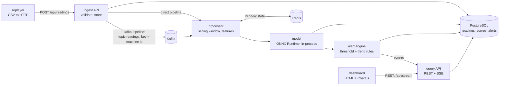

# Architecture

This document describes how the system is built and why. Measured numbers (accuracy, throughput,
latency, restart results) are generated from the results files and live in the README and in
`showcase/RESULTS.md`; nothing here is a measurement.

## The pieces

| Component | Code | Job |
| --- | --- | --- |
| Replayer | `replayer/` | Reads a C-MAPSS file, registers each engine as a machine, posts its rows in cycle order; N machines in parallel (one virtual thread each) under one fleet-wide rate limit |
| Ingest API | `service/.../ingest` | Validates a reading or a batch (known machine, positive cycle, three settings, all 21 sensors), inserts the batch with one statement, hands it on |
| Processor | `service/.../processing` | One sliding window of 30 readings per machine; mean, standard deviation and slope per sensor in O(1) per reading; window state in Redis |
| Model | `service/.../model` | Gradient-boosted trees exported to ONNX, scored in-process; every score stored with its model version |
| Alert engine | `service/.../alerts` | Opens, keeps and closes alerts; sets machine status |
| Query API | `service/.../query` | Fleet list, paginated sensor and health history, alerts, acknowledge, Server-Sent Events |
| Kafka pipeline | `service/.../stream` | Stage 5: ingest publishes and returns; a consumer group drives the processor |
| Dashboard | `dashboard/index.html` | Served by the service at `/`; fleet table, machine charts, live alert panel |

## One reading, end to end

1. The replayer posts `{"machineId": 7, "cycle": 112, "settings": [...], "sensors": {"s1": ..., "s21": ...}}`.
2. `IngestController` accepts an object or an array. `ReadingValidator` checks every reading and lists
   every problem with its index; one bad reading rejects the whole batch with 400.
3. `IngestService` (one transaction) inserts the batch with
   `INSERT ... ON CONFLICT (machine_id, cycle) DO NOTHING`; a repeated post is counted as a duplicate,
   never an error.
4. The reading goes to the `ReadingSink`:
   * **direct pipeline:** the processor runs inside the request;
   * **kafka pipeline:** one message per reading on topic `readings`, key = machine id; the request
     waits for the broker's acknowledgement (`acks=all`) and returns 202. If the broker does not
     acknowledge, the transaction rolls back and the client gets an error to retry.
5. `Processor` finds the machine's window (in memory, else restored from Redis, else new) and applies
   the reading under the ordering rule (below). The window's `RollingStats` per sensor slide in O(1).
6. The 63 features (21 sensors x mean, std, slope) go to `ScoringService`: the ONNX model picks the
   columns it was trained on by name, predicts remaining useful life, clips to [0, 125].
7. The score is inserted into `health_scores` (primary key `(machine_id, cycle)`), then the alert
   engine and the live stream are told.
8. Only now is the window snapshot written to Redis (see "Crash safety").
9. The dashboard receives `score`, `status` and `alert` events over `/api/stream`.

## Ordering rule

The cycle number is the machine's clock (decision record 0004).

| arriving cycle | outcome | window | features and score |
| --- | --- | --- | --- |
| last + 1 | applied | append | yes |
| greater than last + 1 | gap: logged and counted | append | yes |
| less than or equal to last | late: ignored and counted | unchanged | no |

A late reading cannot change a decision already made for a later cycle; inserting it into the middle
of the window would make one cycle produce two different feature vectors depending on arrival order.

## Crash safety and idempotency

* Every table that a reading touches has a primary key on `(machine_id, cycle)`; repeating a write is a no-op.
* Kafka offsets are committed per record, after the processor returns (`AckMode.RECORD`): at-least-once.
* The window is saved to Redis **after** the score and alerts are written. A crash before the save
  means the redelivered message is applied again to the old window, the score insert is a no-op and
  the alert engine skips a cycle it has already seen. (The first version saved first; a crash between
  the save and the score insert would have lost that score, because the redelivery looked late.
  `ProcessorTest` pins the corrected order.)
* If scoring throws, the machine's in-memory window is dropped, so the retry reloads the last saved
  state instead of seeing its own half-applied reading.
* Messages that fail three times go to `readings.DLT`.
* **Known gap: ingest is a dual write.** In the Kafka pipeline the request inserts the reading and publishes it
  inside one database transaction. If the broker acknowledges and the commit then fails, the processor scores a
  reading that is not in `readings`; if the process dies between the insert and the publish, the transaction rolls
  back and the client retries, which is safe. The first case is rare (a commit failing after a successful
  insert) but real. The standard fix is a transactional outbox: write the reading and an outbox row in one
  transaction and let a relay publish the outbox. It is not built here.
* After a restart the alert engine rebuilds each machine's state from PostgreSQL the first time it sees
  it: open alerts, and the recent scores strictly before the current cycle. (The first version also
  loaded the current score, which was already stored, and counted it twice; the alert simulator's
  cross-check found it.) A clear-streak in progress is not restored: an alert that was about to close
  needs K fresh clear readings after a restart. This is the one piece of state a restart resets.

The kill-and-restart experiment (`scripts/restart_test.py`) runs ingest and processor as separate
processes, kills the processor with `taskkill /F` mid-stream, restarts it, and checks that every
reading is stored once, scored once, scored with exactly the value an uninterrupted run would give,
and that every machine's alerts are identical to an uninterrupted run.

## Alerts

* **Threshold rule:** predicted RUL below 60 is WARNING, below 30 is CRITICAL (values from the plan).
* **Trend rule:** least-squares slope of predicted RUL over the last 30 readings below -2 cycles per
  reading (twice the natural rate of 1 cycle per cycle) is WARNING; it counts as clear above -1.5.
* **Warm-up:** no alert opens until the feature window holds 30 readings.
* One open alert per machine and severity; while it is open nothing re-fires.
* An alert closes after its conditions have been clear for K = 5 consecutive readings; a threshold
  counts as clear only 10 cycles above the line (hysteresis), so a prediction hovering at 60 cannot flap.
* Machine status is the most severe open alert, else HEALTHY.

The trend rule first specified (an end-to-end drop of more than 20 over 10 readings) fired on the
model's reading-to-reading jitter and failed the stage 4 check on most validation engines. The
replacement was designed on the validation engines only, with a Python simulator of the alert engine
(`model/alert_sim.py`) that is cross-checked against the service run by run, and confirmed once on the
test engines. Remaining limitation, measured on all 100 engines: a few training engines still close a
WARNING and reopen it within a few cycles; the README reports the count.

## Storage

* `readings`: typed columns, one per sensor (decision 0002); primary key `(machine_id, cycle)` serves
  both chart queries; no other index until a query needs it.
* `health_scores`: one row per scored reading with the model version.
* `alerts`: one row per episode, `closed_at IS NULL` means open; a partial index on open alerts.
* Redis: `window:{machineId}`, a JSON snapshot of the last 30 readings and the last cycle.
* Flyway migrations `V1` to `V4` create everything; the service migrates on start.

## Configuration switches

| Property | Default | Meaning |
| --- | --- | --- |
| `monitor.pipeline` | `direct` | `kafka` puts the topic between ingest and processing |
| `monitor.consumer.enabled` | `true` | run the Kafka consumer in this process (false = ingest-only instance) |
| `monitor.kafka.topic` | `readings` | topic name (tests and experiments use their own) |
| `monitor.window.store` | `redis` | `memory` keeps windows in memory only |
| `monitor.alerts.*` | see `application.yml` | rule parameters |
| `MONITOR_DB_URL`, `MONITOR_REDIS_HOST`, `MONITOR_KAFKA_BOOTSTRAP` | localhost | connections |

## Scaling to 10,000 machines: where it breaks first

* **Processing is per reading and per machine.** In the kafka pipeline the unit of parallelism is the
  partition; six partitions means at most six processing threads per consumer group. More partitions
  and more processor instances scale it horizontally, because machines never share state.
* **PostgreSQL writes** are the first shared resource: three inserts per reading (reading, score,
  occasionally an alert). Batching score inserts per poll and partitioning `readings` by time are the
  next steps (decision 0005).
* **Redis** holds about 6 KB per machine: 10,000 machines is about 60 MB, not a concern; one write per
  reading is.
* **The dashboard stream** sends one `score` event per reading to every client; at fleet scale it must
  be sampled or batched server-side.
