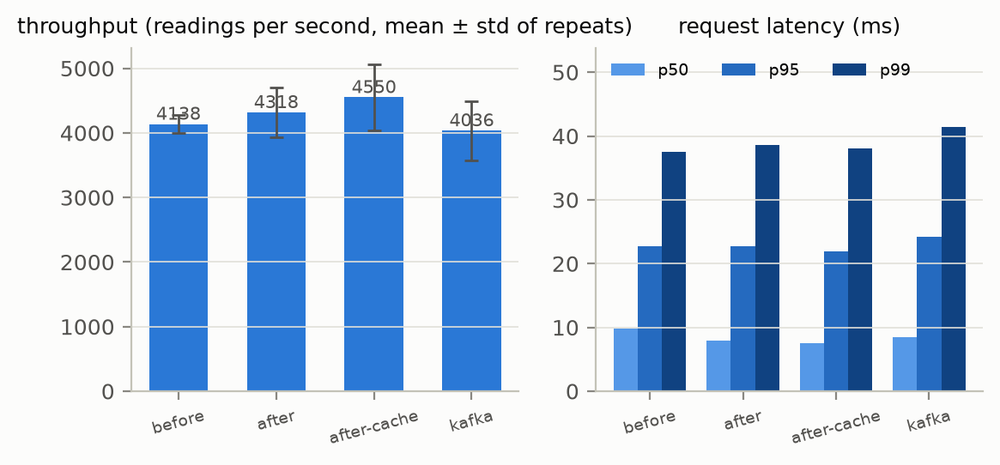

<!-- Generated by model/report.py from report/load-test-report.template.md. -->
# Load test report

**Setup.** k6 runs `loadtest/ingest.js` against `POST /api/readings` for 60 seconds with
50 virtual users and 1 reading per request. Each virtual user owns a set of
machines and posts strictly increasing cycles, so every reading is new and in order. `scripts/loadtest.py` starts the
service, resets a separate `monitor_load` database and its Redis windows, and samples the service's own Micrometer
metrics once a second while k6 runs. `scripts/loadtest_all.py` runs every configuration 3 times,
interleaved, so slow drift of the machine spreads over all configurations. Everything runs on one Windows laptop:
PostgreSQL 17, Redis, Kafka, the service and k6 itself. Treat the numbers as a comparison between configurations,
not as capacity.

| Run         | Pipeline   |   Repeats | Readings/s   |   p50 ms | p95 ms     | p99 ms     |   Pool waits | Change                                                 |
|:------------|:-----------|----------:|:-------------|---------:|:-----------|:-----------|-------------:|:-------------------------------------------------------|
| before      | direct     |         3 | 4138 ± 133   |     9.79 | 22.8 ± 0.4 | 37.5 ± 1.7 |        30.4  | MONITOR_DB_POOL=10 monitor.ingest.cache-machines=false |
| after       | direct     |         3 | 4318 ± 382   |     7.9  | 22.7 ± 1.9 | 38.6 ± 4.6 |         1.35 | MONITOR_DB_POOL=40 monitor.ingest.cache-machines=false |
| after-cache | direct     |         3 | 4550 ± 516   |     7.48 | 21.9 ± 2.5 | 38.1 ± 6.3 |         1.26 | MONITOR_DB_POOL=40 monitor.ingest.cache-machines=true  |
| kafka       | kafka      |         3 | 4036 ± 456   |     8.47 | 24.3 ± 2.1 | 41.4 ± 5.9 |         3.63 | MONITOR_DB_POOL=40 monitor.ingest.cache-machines=true  |

Values are the mean over repeats; ± is the standard deviation between repeats.

## Before

The direct pipeline does everything inside the request: insert, window update, Redis write, ONNX inference, score
insert and alert evaluation. Result: 4138 ± 133 readings per second, p95
22.8 ms, p99 37.5 ms.

**Finding the bottleneck.** The sampled metrics, not a guess, pointed at it:

* requests waiting for a database connection (`hikaricp.connections.pending`): 30.4 on average,
  up to 40;
* process CPU: 41%, so the service was waiting, not computing;
* processing per reading 0.97 ms, of which inference 0.13 ms.

The pool had 10 connections for 50 concurrent requests, and each request holds its
connection for the whole transaction, scoring included.

## After: pool of 40

4318 ± 382 readings per second, p95 22.7 ms, p99 38.6 ms.

* **The bottleneck is gone, reliably.** Pool waits fell from at least 29.2 on average
  in every baseline run to at most 4.4 in every run after the change.
* **The throughput gain is not resolved.** Paired by repeat block, the change moved throughput by
  −5% to 10% (2 of 3 blocks
  positive). The drift between blocks on this laptop is as large as the effect. Removing the wait did not buy clear
  throughput, because the contention moved downstream (see below).

## After: known machines cached

Every request also loaded the fleet's machine ids from PostgreSQL to validate its readings. A later code review
replaced that with an in-memory set that falls back to the database for an id it has not seen (a machine registered
through another instance). Result: 4550 ± 516 readings per second,
p95 21.9 ms, p99 38.1 ms. Paired by block it moved throughput by
3% to 9% over the pool fix; both changes together, −2%
to 20% over the baseline (2 of 3 blocks
positive). It removes one query per request, which is right regardless; its throughput effect is within the noise of
this machine. This is the configuration the service ships.

**Where the next bottleneck is.** CPU sits at 40% and processing takes
2.86 ms per reading, against 0.97 ms in the baseline: more
requests now reach PostgreSQL at once, and each commits three writes. The next step would be measured the same way, with
PostgreSQL wait events sampled during a run; candidate fixes are fewer commits (score inserts batched per Kafka poll) and
shorter transactions (scoring outside the ingest transaction). Not done here.

**What causes the tail.** The p99 sits well above p95 in every configuration. On a laptop that shares every core between
the load generator and the system under test, scheduling and garbage-collection pauses are the likely cause; this was not
separated further.

## The Kafka pipeline (same settings)

Ingest validates, stores and publishes, and returns once the broker has acknowledged. A consumer group of six partitions
does the processing in the same process.

* Ingest: 4036 ± 456 readings per second, p95 24.3 ms, p99
  41.4 ms. Waiting for `acks=all` on every request costs about what skipping the processing saves.
* Processing fell behind: the backlog took 64.9 s on average to drain after k6 stopped, a sustained
  processing rate of 1938 readings per second with six consumer threads.
* Every reading was still scored exactly once.

What Kafka bought is not raw speed on one machine. It is that ingest keeps its latency while processing is slow or down,
the backlog is durable, and processing can scale out by adding partitions and processor instances (see the
kill-and-restart test in the architecture document).

## History

The first version of this report used one run per configuration and did not have the machine cache. Those numbers are
kept in `results/loadtest_single_runs_v1.csv`. They reported the pool fix as a large throughput gain; three
interleaved repeats show that gain is within the run-to-run drift of this machine. The diagnosis (requests queueing for
connections) holds; the size of the speed-up does not.

## Headline

The shipped configuration sustains 4550 ± 516 readings per second at p95
21.9 ms (p99 38.1 ms) on a laptop, mean ± spread of 3
interleaved repeats.
