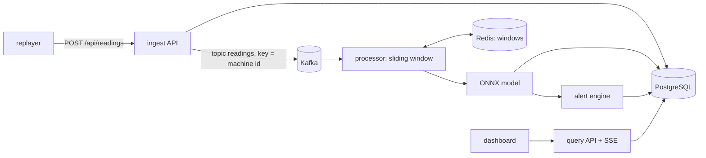

<!-- Generated by model/report.py from report/README.template.md. Edit the template, not this file. -->
# equipment-health-monitor

A Java 21 / Spring Boot service that ingests live sensor readings from turbofan engines, keeps a sliding
window per machine, scores each machine's remaining useful life (RUL) with an in-process ONNX model,
raises de-duplicated alerts, and shows the fleet on a live dashboard. Kafka sits between ingest and
processing; PostgreSQL, Redis, Testcontainers, k6 and Micrometer complete the stack.


## The question

The service should run on as few sensors as possible: every sensor is hardware, wiring and a failure
mode. The sensor-reduction question behind it, asked before any model was trained:

> **Does a model on the 8 highest-ranked sensors predict remaining life as well as one on all 21?**
> Pre-registered as non-inferiority: the 8-sensor model may be worse by less than {{ n.margin }} cycle of
> test RMSE, averaged over {{ n.n_seeds }} seeds.

**Answer: no, not with the pre-registered selection rule.** The 8 ranked sensors are
{{ n.hyp_gap }} cycles worse (paired by seed: {{ n.hyp_gap_min }} to {{ n.hyp_gap_max }}), so the service
ships the 21-sensor model, as the pre-registered deployment rule says.

The rejection is robust. Resampling the {{ n.split_test }} test engines {{ n.boot_draws }} times puts the gap
between {{ n.boot_reduced8_gap_low }} and {{ n.boot_reduced8_gap_high }} cycles (95% interval), entirely above the margin.

Post hoc ablations ask whether the ranking or the number 8 failed. The point estimates say the ranking:

* 8 sensors chosen by forward selection on the validation engines: {{ n.greedy8_gap }} cycles behind the full model;
* the 8 *lowest*-ranked sensors: {{ n.worst8_gap }} cycles behind;
* random 8-sensor draws: between {{ n.random8_best_gap }} and {{ n.random8_worst_gap }} cycles behind.

But those point estimates do **not** establish that any 8 sensors suffice. With {{ n.split_test }} test engines the
95% interval for the forward-selected set runs from {{ n.boot_greedy8_gap_low }} to {{ n.boot_greedy8_gap_high }},
across the margin in both directions; for the lowest-ranked set it is {{ n.boot_worst8_gap_low }} to
{{ n.boot_worst8_gap_high }}. What the data does support is that the
forward-selected set beats the ranked set: by {{ n.boot_greedy8_vs_ranked }} cycles, interval
{{ n.boot_greedy8_vs_ranked_low }} to {{ n.boot_greedy8_vs_ranked_high }}, entirely below zero.Even the
difference between the forward-selected set and the ranked set ({{ n.boot_greedy8_vs_ranked }} cycles, interval
{{ n.boot_greedy8_vs_ranked_low }} to {{ n.boot_greedy8_vs_ranked_high }}) is not resolved.

The ranking picked sensors that move together: their mean pairwise correlation is
{{ n.redundancy_reduced8 }}, against {{ n.redundancy_worst8 }} for the lowest-ranked set. That is a hypothesis
for a new pre-registered test with more test engines, not a conclusion of this one.

## Honesty note

* **The data is a simulation.** NASA C-MAPSS FD001 is a physics-based run-to-failure simulation of
  turbofan engines, a NASA benchmark dataset, not field data from real engines.
* **What was fixed in advance.** The split, metric, window, label cap, model, hyper-parameters, the
  number-of-trees grid, the validation-only selection rule, the seeds, the hypothesis with its margin,
  and the deployment rule are in [`model/config/experiment.json`](model/config/experiment.json),
  committed before the first main result existed. Two amendments touch only how the chosen model is
  shipped: the deployment rule, and float32 ONNX input after the double-precision path proved impossible.
  Because the second landed while the queue was running, the main runs recorded
  {{ n.n_main_config_hashes }} config hashes: {{ n.main_config_hashes }}.
  [`model/config_audit.py`](model/config_audit.py) compares the file with the pre-registration commit field by
  field. Changed: {{ n.config_audit_changed }}. Fields that affect training, selection or evaluation:
  {{ n.config_audit_affecting }}. Verdict: {{ n.config_audit_verdict }}.
* **What was decided afterwards.** Every ablation, the leaky-split comparison, and the redesigned alert
  trend rule are post hoc. They are labelled `posthoc` in [`results/runs.csv`](results/runs.csv) and
  in every table. The alert rule was redesigned on the validation engines and checked once on the test
  engines.
* **Where the numbers come from.** Every number on this page is generated from `results/` by
  `model/report.py`; none is typed by hand. The same numbers feed the paper through `report/numbers.tex`.
* **What is verified where.** GitHub Actions runs the full Java suite against Testcontainers (PostgreSQL,
  Redis, Kafka) and checks that `docker compose up` answers the health check; both pass. The build machine
  has no Docker, so locally the same tests ran against native PostgreSQL 17, Redis and Kafka.
* **What is not verified.** There is no cloud deployment and therefore no live link: it needs an account on a
  hosting provider. All performance numbers come from one Windows laptop.
* **How uncertain the numbers are.** The ± in the model tables is the spread over {{ n.n_seeds }} training seeds.
  It is far smaller than the uncertainty from having only {{ n.split_test }} test engines: resampling those engines
  gives a 95% interval of {{ n.boot_full21_ci_low }} to {{ n.boot_full21_ci_high }} for the 21-sensor RMSE.
  Every comparison below is judged against that interval, not against the seed spread.

## Results

### The model

{{ t.main }}

Test = {{ n.ea_test_rows }} rows of 15 engines never seen in training or selection; mean ± standard deviation
over {{ n.n_seeds }} seeds; the trivial and ridge baselines are deterministic. "Official RMSE" is the
literature's FD001 benchmark (last cycle of each of the 100 truncated test trajectories).

* Gradient boosting on all 21 sensors predicts remaining life to {{ n.main_gbr_full21_test_rmse }} cycles
  RMSE, {{ n.triv_over_gbr }} times better than predicting the mean.
* **15 informative sensors give exactly the same model.** Sensors {{ n.constant_sensors }} are constant in
  FD001; the audit found {{ n.audit_const_splits }} tree splits on them, so dropping them changes nothing.
* **Accuracy misleads.** The trivial model scores {{ n.baseline_trivial_mean_full21_status_acc_pct }}%
  status accuracy because most rows are HEALTHY, yet it never catches a CRITICAL machine
  (CRITICAL recall {{ n.baseline_trivial_mean_full21_critical_recall }}). Macro-F1 and CRITICAL recall
  are reported next to it for that reason.


### Which 8 sensors (post hoc)

{{ t.which8 }}


The pre-registered ranking scored each sensor alone by its rank correlation with RUL. It picked sensors
{{ n.reduced8_sensors }}. They all track the same degradation signal: the mean absolute correlation between
their window means is {{ n.redundancy_reduced8 }}, so 8 of them carry little more than one. The ranking left
out sensors {{ n.audit_top_outside }}, which carry {{ n.audit_importance_outside_pct }}% of the full model's
importance. Forward selection on validation picked {{ n.greedy8_sensors }} (redundancy {{ n.redundancy_greedy8 }}).
The lowest-ranked set has redundancy {{ n.redundancy_worst8 }}. "Within 1.0" in the table compares point estimates
only; the engine-level intervals above show that none of the post hoc sets is established as non-inferior.


### The recipe matters as much as the idea (post hoc)

{{ t.recipe }}


The 8 ranked sensors never reach the margin, but the size of the gap depends on the window length. The
window length alone moves the 21-sensor error by {{ n.window_effect_full21 }} cycles, about as much as
the sensor reduction does. **Read the main result as "under this recipe", not as a property of the sensors.**

### The methodological gap (post hoc)

Splitting rows at random, so that cycles of one engine land in both training and test, reports
{{ n.rowsplit_rmse }} cycles RMSE for the same model. That is {{ n.rowsplit_optimism }} cycles
({{ n.rowsplit_optimism_pct }}%) better than the honest engine-level split, and all of it is leak.
`tests/test_split.py` fails if any engine appears in two splits.

### The service

| Check | Result |
| --- | --- |
| Stage 1: all {{ n.eda_engines }} engines replayed, rows in PostgreSQL = rows in the file | {{ n.restart_readings_rows }} = {{ n.restart_file_rows }} |
| Stage 3: Java ONNX prediction vs Python, {{ n.parity_rows }} real test rows | within the 1e{{ n.cfg_parity_tol_exp }} tolerance; {{ n.java_us_per_prediction }} µs per prediction |
| Stage 4: held-out engines with exactly one WARNING then one CRITICAL | {{ n.alert_replay_test_engines_passing }} of {{ n.alert_replay_test_engines }} |
| Stage 4: true cycles left when CRITICAL opens (mean, minimum) | {{ n.alert_replay_test_mean_true_rul_at_critical }}, {{ n.alert_replay_test_min_true_rul_at_critical }} |
| Stage 5: processor killed mid-stream, readings stored / scored | {{ n.restart_readings_rows }} / {{ n.restart_health_scores_rows }} of {{ n.restart_file_rows }} |
| Stage 5: scores and alerts identical to an uninterrupted run | max score difference {{ n.restart_max_diff }}; {{ n.restart_machines_with_alerts_different_from_uninterrupted_run }} machines differ |
| Tests | {{ n.tests_java }} Java, {{ n.tests_python }} Python, all passing |
| Line coverage, processing and alert code | {{ n.coverage_processing_alerts }}% |

**Throughput:** {{ n.lt_after_cache_rps }} ± {{ n.lt_after_cache_rps_std }} readings per second at p95 latency of
{{ n.lt_after_cache_p95 }} ms (p99 {{ n.lt_after_cache_p99 }} ms) for the shipped configuration on a laptop, k6 against
`POST /api/readings`, mean ± spread of {{ n.lt_after_cache_runs }} interleaved repeats. The first bottleneck (requests
queueing for database connections) was found from metrics and removed in every repeat, but the throughput gain from
removing it ({{ n.lt_total_gain_min }}% to {{ n.lt_total_gain_max }}% per repeat block) is within this machine's drift.

{{ t.loadtest }}


Details, the bottleneck found and the fix: [`docs/load-test-report.md`](docs/load-test-report.md).

## Error analysis

The service turns a predicted RUL into a status (HEALTHY above 60, WARNING, CRITICAL below 30), so errors are
counted as status confusions: {{ n.ea_misclassified_rows }} of {{ n.ea_test_rows }} test rows
({{ n.ea_misclassified_pct }}%). The most frequent is WARNING predicted as HEALTHY ({{ n.ea_top_confusion_rows }}
rows), then WARNING predicted as CRITICAL ({{ n.ea_second_confusion_rows }}). HEALTHY was never predicted
CRITICAL ({{ n.ea_healthy_as_critical_rows }} rows), nor the reverse ({{ n.ea_critical_as_healthy_rows }}).

{{ n.ea_inspected }} misclassified rows were inspected by eye on whole-engine plots
([`error_analysis/`](error_analysis/)):

* **{{ n.ea_ambiguous }} ambiguous:** a small error that crosses a neighbouring boundary. Across all
  misclassified rows, {{ n.ea_small_error_pct }}% have an error of 10 cycles or less.
* **{{ n.ea_mislabeled }} mislabeled:** FD001 labels are exact cycle counts from a simulation, so none were expected.
* **{{ n.ea_model }} real model errors**, in four shapes:
  * lagging ({{ n.ea_pattern_lagging }}): the prediction stays high on engines that fail fast, because early
    sensors cannot know how fast an engine will degrade;
  * early ({{ n.ea_pattern_early }}): the prediction runs ahead of the truth near the end of long-lived engines;
  * jitter ({{ n.ea_pattern_jitter }}): single-reading spikes or steps;
  * plateau ({{ n.ea_pattern_plateau }}): tree output stuck near 60, exactly on the WARNING line.


## How it works



One reading, end to end, the ordering rule, crash safety and the alert semantics are in
[`docs/architecture.md`](docs/architecture.md).

## Design decisions

| Decision | Choice | Why, in one line |
| --- | --- | --- |
| [Kafka between ingest and processing](docs/decisions/0001-kafka-between-ingest-and-processing.md) | yes, added in stage 5 | a processor crash loses nothing, and ingest latency no longer includes the model |
| [Sensor values](docs/decisions/0002-sensor-columns-vs-json.md) | typed columns | fixed schema, half the bytes of JSON, typed validation at insert |
| [Model serving](docs/decisions/0003-onnx-in-process.md) | ONNX Runtime in-process | microseconds instead of an HTTP hop; a parity test guards it |
| [Window state](docs/decisions/0004-window-state-and-ordering.md) | Redis, saved after scoring | a restart resumes exactly; late readings are ignored, gaps tolerated |
| [Storage](docs/decisions/0005-postgresql-vs-time-series-database.md) | PostgreSQL | the hot window lives in Redis; the volume does not need a TSDB yet |
| [Live updates](docs/decisions/0006-server-sent-events-vs-websockets.md) | Server-Sent Events | one-way, plain HTTP, reconnects by itself |

## Mistakes caught on the way

* The first alert trend rule fired on the model's reading-to-reading jitter. It passed the stage 4 check
  on only {{ n.alert_original_pass }} of 15 validation engines.
* A Python simulator of the alert engine, cross-checked against the service, exposed a Java bug: the
  first score after a restart was counted twice.
* The processor saved the window before scoring it, so a crash between the two would have lost a score.
* Integration tests shared the dev Redis and left windows behind, and every later reading was ignored as late.
* On Windows, deleting a Kafka topic makes the broker shut down, so experiments use a fresh topic per run.
* (Found in a later review.) The tables reported the spread over training seeds as if it were the uncertainty.
  Resampling the test engines gives intervals about {{ n.boot_ci_over_seed }} times wider, and the post hoc claims that
  some 8-sensor sets land "inside the margin" did not survive it.
* (Found in a later review.) Machine names reached the dashboard as raw HTML: anyone who can call the API could
  inject script into every viewer's page. The dashboard now escapes everything and registration refuses markup.
* (Found in a later review.) Live dashboard events were written on the processing thread, so one slow browser
  could stall scoring. They now go through a bounded queue on their own thread.
* (Found in a later review.) Every ingest request loaded all machine ids from PostgreSQL to validate one reading;
  ids are now cached, with a database lookup for machines registered elsewhere.

## Limitations

* FD001 is one operating condition and one fault mode, simulated. Nothing here shows the model or the
  alert thresholds transfer to FD002 to FD004, let alone to real engines.
* The alert rule passes on all held-out engines, but replaying all 100 engines, including training
  engines, gives {{ n.all_engines_alert_pass }} of 100: a few close a WARNING and reopen it within a few cycles.
* After a restart, an alert that was about to close needs a fresh run of clear readings: its clear
  streak is not persisted.
* One split with {{ n.split_test }} test engines bounds every comparison. The pre-registered verdict compares the mean
  with the margin; an interval-based rule would have been stricter. Both are reported, and the main rejection passes
  both. The post hoc comparisons pass neither.
* In the Kafka pipeline, ingest writes to PostgreSQL and Kafka without a shared transaction. A commit that fails after
  the broker acknowledged leaves a scored reading with no stored row. A transactional outbox would close the gap; it is
  documented in `docs/architecture.md`, not built.
* The API has no authentication: anyone who can reach it can register machines, post readings and acknowledge alerts.
  That is acceptable for a local demo, not for a deployment.
* Performance numbers are from one laptop with everything running on it.

## Repository map

```
model/            Python: data, features, training, ONNX export, ablations, alert simulator, report
  config/experiment.json   the pre-registered recipe
service/          Spring Boot service (ingest, processing, model, alerts, query, stream, config)
replayer/         command-line replayer
dashboard/        index.html (served by the service at /)
loadtest/         k6 script
scripts/          run_queue (resumable), reproduce, demo, alert_replay, restart_test, loadtest, reset_dev
data/splits/      frozen engine split and the sensor sets of each arm (raw data is not committed)
results/          runs.csv, logs, every experiment's JSON; numbers.json
report/           paper (IEEE), numbers.tex, figures, tables, templates
learn/            Learn.pdf, the from-scratch tutorial
showcase/         RESULTS.md, figures, PDFs, demo screenshot and video, social cards, post drafts
docs/             architecture, decision records, load-test report, the build plan
tests/            pytest invariants (split leak, features, metrics, ONNX parity)
error_analysis/   the inspected samples, the labels, the plots
```

## Reproduce

```bash
python scripts/reproduce.py --quick
```

`--quick` checks the frozen split, runs the Python tests, rebuilds the features, recomputes every table,
figure and number from `results/`, and runs the Java build and tests. Without `--quick` it also re-runs
any missing experiment through the resumable queue. That takes hours on a laptop; runs already in
`results/runs.csv` are skipped. The raw data is downloaded from NASA's data portal on first use.

Run the system. The first command starts PostgreSQL, Redis and the service; the next two build the replayer and
fetch the data (the reproduction script downloads FD001 and checks it); the last streams all 100 engines.

```bash
docker compose up
```

```bash
./mvnw -pl replayer -am package -DskipTests
```

```bash
python scripts/reproduce.py --quick
```

```bash
java -jar replayer/target/replayer.jar --file data/raw/train_FD001.txt
```

Open http://localhost:8080 to watch the fleet.

## Demo

[`showcase/demo_video.webm`](showcase/demo_video.webm) is a recording of the dashboard while the 15 held-out
engines stream in, made by `scripts/demo.py`. The same script checks the prediction it shows: the
dashboard, the API and the Python model agree on the predicted remaining life of the engine on screen.


## Further reading

* [`report/paper.pdf`](report/paper.pdf): the write-up in IEEE conference format.
* [`learn/Learn.pdf`](learn/Learn.pdf): a from-scratch tutorial, from the domain to the interview questions.
* Saxena, Goebel, Simon, Eklund (2008), the dataset paper; Pelkonen et al. (2015), Gorilla; Kreps, Narkhede,
  Rao (2011), Kafka; Sculley et al. (2015), hidden technical debt in ML systems.
