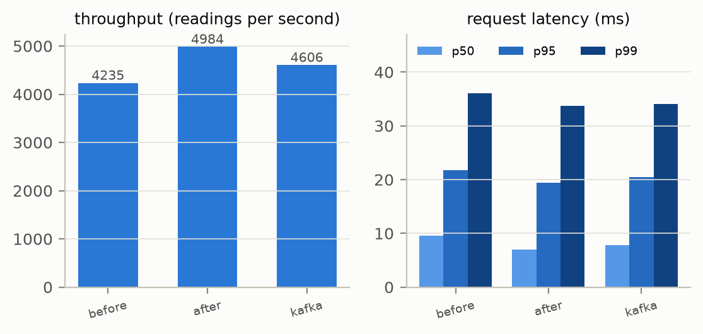

<!-- Generated by model/report.py from report/load-test-report.template.md. -->
# Load test report

**Setup.** k6 runs `loadtest/ingest.js` against `POST /api/readings` for 60 seconds with {{ n.lt_before_vus }} virtual users and
{{ n.lt_before_batch }} reading per request. Each virtual user owns a set of machines and posts strictly increasing cycles, so
every reading is new and in order. `scripts/loadtest.py` starts the service, resets a separate `monitor_load` database and
its Redis windows, and samples the service's own Micrometer metrics once a second while k6 runs. Everything runs on one
Windows laptop: PostgreSQL 17, Redis, Kafka, the service and k6 itself. Treat the numbers as a comparison between runs,
not as capacity.

{{ t.loadtest }}

## Run 1: before

The direct pipeline does everything inside the request: insert, window update, Redis write, ONNX inference, score
insert and alert evaluation. Result: {{ n.lt_before_rps }} readings per second, p95 {{ n.lt_before_p95 }} ms,
p99 {{ n.lt_before_p99 }} ms.

**Finding the bottleneck.** The sampled metrics, not a guess, pointed at it:

* requests waiting for a database connection (`hikaricp.connections.pending`): {{ n.lt_before_pool_pending }} on average,
  up to {{ n.lt_before_pool_pending_max }};
* process CPU: {{ n.lt_before_cpu_pct }}%, so the service was waiting, not computing;
* processing per reading {{ n.lt_before_processing_ms }} ms, of which inference {{ n.lt_before_inference_ms }} ms.

The pool had {{ n.lt_before_pool }} connections for {{ n.lt_before_vus }} concurrent requests, and each request holds its
connection for the whole transaction, scoring included. Most of a request's time was spent queueing for a connection.

## Run 2: after (one change: pool size {{ n.lt_after_pool }})

{{ n.lt_after_rps }} readings per second ({{ n.lt_gain_pct }}% more), p50 {{ n.lt_after_p50 }} ms, p95 {{ n.lt_after_p95 }} ms,
p99 {{ n.lt_after_p99 }} ms. Pool waits fell to {{ n.lt_after_pool_pending }} on average.

**Where the next bottleneck is.** Processing per reading rose from {{ n.lt_before_processing_ms }} to
{{ n.lt_after_processing_ms }} ms while CPU stayed at {{ n.lt_after_cpu_pct }}%. More requests now reach the database at
once, and each one commits three writes. The next step would be measured the same way, with PostgreSQL wait events
sampled during a run. The candidate fixes are fewer commits (score inserts batched per Kafka poll) and shorter
transactions (score outside the ingest transaction). This was not done here.

**What causes the tail.** The p99 stays a little above p95 in every run. On a laptop that shares every core between the
load generator and the system under test, scheduling and garbage-collection pauses are the likely tail; this was not
separated further.

## Run 3: the Kafka pipeline (same pool)

Ingest now validates, stores and publishes, and returns once the broker has acknowledged. A consumer group of six
partitions does the processing in the same process.

* Ingest: {{ n.lt_kafka_rps }} readings per second, p95 {{ n.lt_kafka_p95 }} ms, p99 {{ n.lt_kafka_p99 }} ms. That is
  **not faster** than the tuned direct pipeline: waiting for `acks=all` on every request costs about what the
  processing it skips did.
* Processing fell behind: the backlog took {{ n.lt_kafka_drain_s }} s to drain after k6 stopped, a sustained processing
  rate of {{ n.lt_kafka_processed_rps }} readings per second with six consumer threads.
* Every reading was still scored exactly once ({{ n.lt_kafka_scored }}).

What Kafka bought is not raw speed on one machine. It is that ingest keeps its latency while processing is slow or
down, the backlog is durable, and processing can scale out by adding partitions and processor instances (see the
kill-and-restart test in the architecture document).

## Headline

{{ n.lt_best_rps }} readings per second at p95 {{ n.lt_best_p95 }} ms (p99 {{ n.lt_best_p99 }} ms) on a laptop, run
"{{ n.lt_best_label }}".
